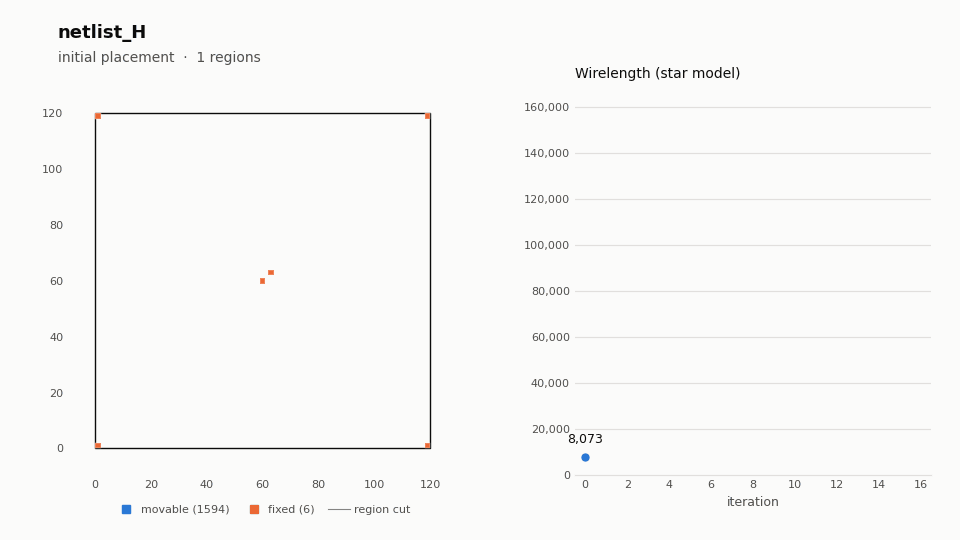

# Build Gordian Placement on Linux



## Description

This project is based on the source code of Gordian Placement ([GitHub Repository](https://github.com/KangliC/Gordian_Placement)) and focuses on building a Linux-compatible version.

GORDIAN is a global placement algorithm: it minimises a quadratic wirelength
objective, cuts every region with too many cells in two, adds one
center-of-mass constraint per region, and solves again, until every region
holds at most 5 movable cells. The animation above shows this loop on
`testcases/netlist_H.txt`: each frame is one quadratic solve plus the region
cuts derived from it.

## Quick start (Docker, no sudo needed)

The build needs BLAS/LAPACK. If you cannot `apt install` them (no root), use the
Docker image, which contains the compiler, BLAS/LAPACK and the Python
visualisation dependencies. You only need to be in the `docker` group.

```sh
scripts/run_docker.sh testcases/netlist_L.txt
```

This builds the image (cached after the first run), places the netlist and
writes everything to `output/netlist_L/`:

```
output/netlist_L/
├── placement.gif        # animation (see above)
├── placement.txt        # final cell positions
└── snapshots/           # one text snapshot per iteration (input of the GIF)
```

A custom output directory and extra options can follow the netlist:

```sh
scripts/run_docker.sh testcases/netlist_H.txt output/H --bmp
```

The netlist and the output directory must be inside the current directory,
because that is what gets mounted into the container.

To work inside the container manually:

```sh
docker build -t gordian .
docker run --rm -it -u "$(id -u):$(id -g)" -v "$PWD":/work gordian bash
gordian testcases/netlist_L.txt -o output/netlist_L
gordian-visualize output/netlist_L
```

## Native build (if BLAS/LAPACK are installed)

```sh
sudo apt install -y build-essential cmake libblas-dev liblapack-dev   # needs root
cmake -S . -B build
cmake --build build -j
./build/gordian_linux_build testcases/netlist_L.txt
```

`python3 scripts/visualize.py output/netlist_L` then renders the GIF (needs
`matplotlib` and `Pillow`).

## Usage

```
gordian_linux_build [options] [netlist]

  -o, --output DIR   output directory (default: output)
      --bmp          also write a BMP image per iteration (legacy EasyBMP output)
      --no-snapshots do not write snapshots (used for the GIF)
  -h, --help         show this help
```

If no netlist is given, the path is read from standard input, like the original program.

```
scripts/visualize.py RESULT_DIR [-o out.gif] [--title T] [--frame-ms 700] [--hold-ms 2500] [--dpi 100]
```

## Netlist format

```
Num_Cells=76
Num_Mcells=74
Num_Fcells=2
Num_Nets=56
W=60
H=60
N(1)                         # start of a net
C(0)(2,2)(0,1)F(1,1)         # cell 0, size 2x2, pin offset (0,1), fixed at (1,1)
C(20)(2,2)(0,-1)M            # cell 20, size 2x2, pin offset (0,-1), movable
...
```

## Test cases

Measured with the Docker image (Release build):

| Netlist | Cells (movable / fixed) | Nets | Iterations | Regions | Wirelength | Time |
|---|---|---|---|---|---|---|
| `custom_netlist1` | 74 / 2 | 56 | 6 | 9 | 1,267 | < 0.1 s |
| `netlist_L` | 394 / 6 | 874 | 10 | 112 | 20,561 | 0.7 s |
| `netlist_H` | 1594 / 6 | 3354 | 16 | 450 | 150,698 | 80 s |
| `custom_netlist2` | 1794 / 6 | 3754 | 18 | 509 | 191,257 | 133 s |

Wirelength is the star model: the sum of Euclidean distances from each pin to
its net's centroid.

## Changes from the original code

The algorithm is unchanged: on `netlist_L` every cell position and region
assignment matches the original bit for bit at every iteration. The code was
restructured and a few bugs were fixed:

- **Command line**: the netlist path and output directory are arguments, and the
  program exits normally (the original ended in `while(1);`).
- **Release builds work**: `netlist_read()` had no `return`, which is undefined
  behaviour and crashed at `-O2`. CMake now defaults to Release, about 2x faster
  than the original Debug build, and the quadratic system is factorised once
  per iteration instead of once per axis.
- **Empty regions**: when the cut search found no balanced cut, the original
  moved the cut line to absolute coordinate 0, which could leave a region with
  no cells (and then read past the end of an empty list). The cut now falls
  back to the region's original center, and a cut that separates nothing is
  undone. This affects `netlist_H` from iteration 11 on.
- **Floating cells**: cells with no path to a fixed cell (most cells in both
  `custom_netlist*` cases) made the system singular, so cells were placed far
  outside the chip (coordinates around ±1000 on a 60×60 chip). These cells now
  get a weak spring (weight 0.01) toward their region center, and a warning
  is printed. Netlists without floating cells are unaffected. Cells in the
  same floating chain still stack on top of each other, because nothing in
  the netlist pulls them apart.
- **Wirelength** now includes every net. The original skipped the last net.
- **Netlist parsing** checks the input and reports `file:line` errors instead of
  hanging. It accepts CRLF line endings and any order of header keys, and no
  longer overflows the fixed 16-entry pin array.
- **Visualisation**: per-iteration snapshots plus `scripts/visualize.py`
  produce the GIF. The BMP output is still available with `--bmp`.

## Project layout

```
src/main.cpp            command-line interface
src/Gordian.{h,cpp}     netlist parser, quadratic solver, partitioning, output
src/EasyBMP*            BMP writer (only used with --bmp)
src/include/            vendored Armadillo 4.450 (header only)
scripts/visualize.py    snapshots -> animated GIF
scripts/run_docker.sh   build image + place + render in one command
Dockerfile              build/runtime environment
testcases/              sample netlists
docs/                   GIFs used in this README
```
